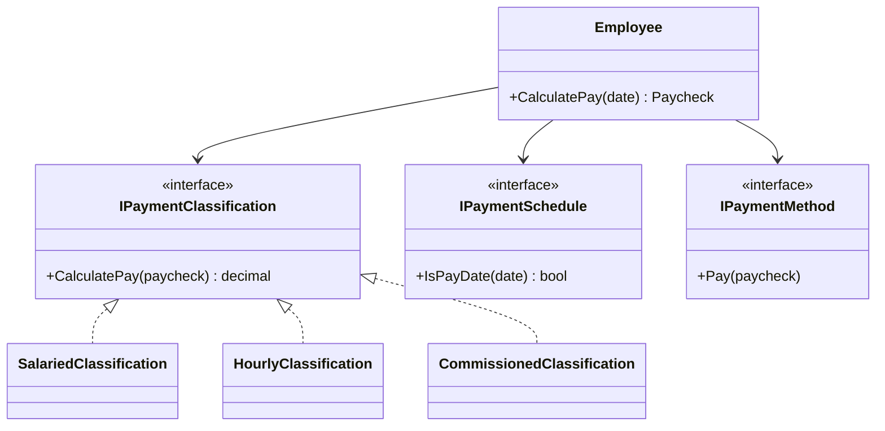

# Agile Software Development: Principles, Patterns, and Practices

> **Author:** Robert C. Martin ("Uncle Bob") · **Published:** 2002 (Java/C++). A **C# edition** — *Agile Principles, Patterns, and Practices in C#* (2006, with Micah Martin) — has the same content with C# examples.
> **One-line summary:** The book where **SOLID** was introduced to the world, together with the design patterns and package principles you need to apply it — taught through real case studies (Payroll, Weather Station) built with Agile/XP practices.
> **Examples in this guide:** modern C# 12 / .NET 8+.

---

## Table of Contents

1. [What the Book Actually Covers](#1-what-the-book-actually-covers)
2. [Core Teachings with C# Examples](#2-core-teachings-with-c-examples)
   - **Section I – Agile Development**
     - 2.1 [Agile Practices & XP](#21-agile-practices--xp)
     - 2.2 [Planning, Testing, Refactoring](#22-planning-testing-refactoring)
     - 2.3 [A Programming Episode – The Bowling Game](#23-a-programming-episode--the-bowling-game)
   - **Section II – Agile Design**
     - 2.4 [Design Smells – How Software Rots](#24-design-smells--how-software-rots)
     - 2.5 [SRP – Single Responsibility Principle](#25-srp--single-responsibility-principle)
     - 2.6 [OCP – Open/Closed Principle](#26-ocp--openclosed-principle)
     - 2.7 [LSP – Liskov Substitution Principle](#27-lsp--liskov-substitution-principle)
     - 2.8 [DIP – Dependency Inversion Principle](#28-dip--dependency-inversion-principle)
     - 2.9 [ISP – Interface Segregation Principle](#29-isp--interface-segregation-principle)
   - **Section III – Design Patterns (from the case studies)**
     - 2.10 [Command & Active Object](#210-command--active-object)
     - 2.11 [Template Method & Strategy](#211-template-method--strategy)
     - 2.12 [Facade & Mediator](#212-facade--mediator)
     - 2.13 [Singleton & Monostate](#213-singleton--monostate)
     - 2.14 [Null Object](#214-null-object)
     - 2.15 [Factory](#215-factory)
     - 2.16 [Composite](#216-composite)
     - 2.17 [Observer](#217-observer)
     - 2.18 [Abstract Server, Adapter & Bridge](#218-abstract-server-adapter--bridge)
     - 2.19 [Proxy & Gateway](#219-proxy--gateway)
     - 2.20 [Visitor (and Acyclic Visitor, Decorator, Extension Object)](#220-visitor-and-acyclic-visitor-decorator-extension-object)
     - 2.21 [State](#221-state)
   - **Section IV – Packaging**
     - 2.22 [Principles of Package Design](#222-principles-of-package-design)
   - **Section V – UML**
     - 2.23 [UML, Used Pragmatically](#223-uml-used-pragmatically)
3. [The Payroll Case Study – Condensed in C#](#3-the-payroll-case-study--condensed-in-c)
4. [Pattern Selection Cheat Sheet](#4-pattern-selection-cheat-sheet)
5. [Applying It in .NET + React + Azure Projects](#5-applying-it-in-net--react--azure-projects)
6. [Interview Questions & Answers](#6-interview-questions--answers)
7. [Key Takeaways](#7-key-takeaways)

---

## 1. What the Book Actually Covers

This is Uncle Bob's **biggest and most technical** book. It won a Jolt Award and is where **SOLID** (as a collection) was first fully described. It's long (~500+ pages), but its structure is simple:

| Section | Content |
|---|---|
| **I. Agile Development** | Agile Manifesto, XP practices, planning, testing, refactoring (prime number generator), a full pair-programming episode (bowling game) |
| **II. Agile Design** | The 7 **design smells** + the 5 **SOLID** principles, each with examples |
| **III. Payroll Case Study** | A full system designed incrementally. Introduces patterns: Command, Active Object, Template Method, Strategy, Facade, Mediator, Singleton, Monostate, Null Object, Factory |
| **IV. Packaging the Payroll System** | The 6 **package principles** (REP, CRP, CCP, ADP, SDP, SAP) + metrics (Instability, Abstractness, Main Sequence) |
| **V. Weather Station Case Study** | Composite, Observer, Abstract Server, Adapter, Bridge, Proxy, Stairway to Heaven, Visitor family, State |
| **VI. ETS Case Study** | A real-world testing system design (Educational Testing Service) |
| **(C# edition)** | Extra UML chapters (class, sequence, state, object diagrams) and all code in C# |

**Central message:**

> **Agile design is a process, not an event.** Good design emerges from applying principles and patterns **continuously**, in small steps, guided by tests — **not** from a big up-front design document. You apply a principle *when you smell the problem it solves*, not "just in case."

---

## 2. Core Teachings with C# Examples

## Section I – Agile Development

### 2.1 Agile Practices & XP

**The 12 principles behind the Agile Manifesto** (paraphrased):
1. Highest priority: satisfy the customer through early and continuous delivery of valuable software.
2. Welcome changing requirements, even late.
3. Deliver working software frequently (weeks, not months).
4. Business people and developers work together daily.
5. Build projects around motivated individuals; trust them.
6. Face-to-face conversation is the most efficient communication.
7. **Working software is the primary measure of progress.**
8. Sustainable pace — indefinitely.
9. **Continuous attention to technical excellence and good design enhances agility.**
10. Simplicity — maximizing the work *not* done — is essential.
11. The best architectures, requirements, and designs emerge from self-organizing teams.
12. The team regularly reflects and adjusts.

**XP practices** covered: Customer team member, user stories, short cycles, acceptance tests, pair programming, TDD, collective ownership, continuous integration, sustainable pace, open workspace, planning game, simple design, refactoring, metaphor. *(Detailed in [04 – Clean Agile](04-Clean-Agile.md).)*

---

### 2.2 Planning, Testing, Refactoring

#### Planning
- **Release planning:** pick stories for the next release (~3 months) based on velocity.
- **Iteration planning:** pick stories for the next 1–2 weeks.
- **Tasks:** developers break stories into tasks (~4–16 hours) and sign up for them.

#### Testing
- **Test-first design:** writing the test first forces you to think from the *caller's* perspective, which naturally produces **decoupled, testable** designs.
- **Test isolation** forces decoupling. If a `Payroll` class is hard to test because it talks to a DB, the fix is to introduce an interface (DIP) — the **test told you about the design problem.**
- **Serendipitous decoupling:** tests make you separate things you wouldn't have otherwise.
- **Acceptance tests** = executable requirements, written by the customer (e.g., FitNesse).

```csharp
// The test forced the design: Payroll needs an IEmployeeDatabase and IPayCheckWriter,
// not a concrete SQL connection and printer.
[Fact]
public void Payroll_PaysAllEmployeesWhoArePayable()
{
    var db = new InMemoryEmployeeDatabase(MockEmployee.PayableToday("Bob", 1000m));
    var writer = new SpyCheckWriter();
    var payroll = new Payroll(db, writer, new FixedClock(new DateOnly(2026, 11, 30)));

    payroll.Run();

    Assert.Single(writer.Checks);
    Assert.Equal(1000m, writer.Checks[0].Amount);
}
```

#### Refactoring — the Prime Generator example
Uncle Bob takes an ugly but working "Sieve of Eratosthenes" method and refactors it into small, intention-revealing methods. Lessons:
- Refactor in **tiny steps**, running tests after each.
- **Extract method** until each method does one thing.
- Rename for intent.
- Refactoring is like **cleaning the kitchen after dinner** — skip it and the mess compounds.

```csharp
// After refactoring – reads like the algorithm description
public static class PrimeGenerator
{
    public static IReadOnlyList<int> GeneratePrimes(int maxValue)
    {
        if (maxValue < 2) return [];
        var crossedOut = new bool[maxValue + 1];
        CrossOutMultiples(crossedOut);
        return CollectUncrossedIntegers(crossedOut);
    }

    private static void CrossOutMultiples(bool[] crossedOut)
    {
        var limit = (int)Math.Sqrt(crossedOut.Length - 1);
        for (var i = 2; i <= limit; i++)
            if (!crossedOut[i])
                CrossOutMultiplesOf(i, crossedOut);
    }

    private static void CrossOutMultiplesOf(int i, bool[] crossedOut)
    {
        for (var multiple = i * i; multiple < crossedOut.Length; multiple += i)
            crossedOut[multiple] = true;
    }

    private static List<int> CollectUncrossedIntegers(bool[] crossedOut) =>
        Enumerable.Range(2, crossedOut.Length - 2).Where(n => !crossedOut[n]).ToList();
}
```

---

### 2.3 A Programming Episode – The Bowling Game

The famous chapter: Uncle Bob and Bob Koss pair-program a bowling score calculator using TDD. They start by sketching a UML design with `Game`, `Frame`, `Throw` classes… and **TDD leads them to a much simpler design** with no `Frame` or `Throw` classes at all.

**Lesson:** Up-front design is a hypothesis. **Tests reveal the simplest design that actually works.** Don't build the classes your diagram says you need; build what the tests demand.

**Rules of bowling (summary):** 10 frames. Each frame: up to 2 rolls to knock down 10 pins.
- **Spare** (10 pins in 2 rolls): bonus = next 1 roll.
- **Strike** (10 pins in 1 roll): bonus = next 2 rolls.
- 10th frame: bonus rolls allowed.

#### Tests (written one at a time, each followed by the minimal code)

```csharp
public class BowlingGameTests
{
    private readonly Game _game = new();

    private void RollMany(int rolls, int pins) { for (var i = 0; i < rolls; i++) _game.Roll(pins); }
    private void RollSpare()  { _game.Roll(5); _game.Roll(5); }
    private void RollStrike() => _game.Roll(10);

    [Fact] public void GutterGame()  { RollMany(20, 0); Assert.Equal(0,  _game.Score); }
    [Fact] public void AllOnes()     { RollMany(20, 1); Assert.Equal(20, _game.Score); }

    [Fact]
    public void OneSpare()
    {
        RollSpare(); _game.Roll(3); RollMany(17, 0);
        Assert.Equal(16, _game.Score);
    }

    [Fact]
    public void OneStrike()
    {
        RollStrike(); _game.Roll(3); _game.Roll(4); RollMany(16, 0);
        Assert.Equal(24, _game.Score);
    }

    [Fact] public void PerfectGame() { RollMany(12, 10); Assert.Equal(300, _game.Score); }
}
```

#### The emergent production code — far simpler than the UML sketch

```csharp
public sealed class Game
{
    private const int Frames = 10;
    private readonly int[] _rolls = new int[21];
    private int _current;

    public void Roll(int pins) => _rolls[_current++] = pins;

    public int Score
    {
        get
        {
            var score = 0;
            var i = 0;
            for (var frame = 0; frame < Frames; frame++)
            {
                if (IsStrike(i))       { score += 10 + StrikeBonus(i); i += 1; }
                else if (IsSpare(i))   { score += 10 + SpareBonus(i);  i += 2; }
                else                   { score += SumOfBallsInFrame(i); i += 2; }
            }
            return score;
        }
    }

    private bool IsStrike(int i) => _rolls[i] == 10;
    private bool IsSpare(int i) => _rolls[i] + _rolls[i + 1] == 10;
    private int StrikeBonus(int i) => _rolls[i + 1] + _rolls[i + 2];
    private int SpareBonus(int i) => _rolls[i + 2];
    private int SumOfBallsInFrame(int i) => _rolls[i] + _rolls[i + 1];
}
```

> This is also one of the most popular **katas** — practice it until it's automatic.

---

## Section II – Agile Design

### 2.4 Design Smells – How Software Rots

Software "rots" when its design degrades. The **7 smells** tell you it's happening:

| Smell | Definition | Real-world symptom |
|---|---|---|
| **Rigidity** | Hard to change; one change cascades into many | "Adding a tax rule took 3 weeks and touched 40 files." |
| **Fragility** | Changes break unrelated places | "We fixed the invoice PDF and now login is broken." |
| **Immobility** | Can't reuse parts in other systems; too entangled | "We'd love to reuse the pricing engine in the mobile backend, but it drags the whole web app with it." |
| **Viscosity** | Doing the right thing is harder than hacking | "It takes 40 minutes to build/test, so people skip tests." / "Adding an interface properly takes 2 hours, so we just add another `if`." |
| **Needless Complexity** | Infrastructure for features nobody needs | "We have a plugin system with one plugin." |
| **Needless Repetition** | Copy-paste code | "We fixed the VAT bug in 3 places but there were 5." |
| **Opacity** | Hard to understand | "Only Raj understands the billing module, and he's on leave." |

**Why does software rot?** Because **requirements change** in ways the initial design didn't anticipate. The fix is not a better crystal ball; it's **keeping the design clean and flexible continuously**, applying principles when smells appear.

#### The "Copy" program example (from the book)

A `Copy` routine reads from the keyboard and writes to a printer. New requirement: sometimes read from paper tape. A naive developer adds a `bool ptFlag`. Then another requirement: write to paper-tape punch → another flag. The design **rots**.

The Agile developer, at the **first** change, applies **DIP + OCP**: introduce a `Reader` abstraction.

```csharp
// ❌ Rotting with flags
public static void Copy(bool readFromTape, bool writeToPunch)
{
    int c;
    while ((c = readFromTape ? PaperTape.Read() : Keyboard.Read()) != -1)
        if (writeToPunch) Punch.Write(c); else Printer.Write(c);
}

// ✅ Agile response at the first change: invert dependencies
public interface IReader { int Read(); }
public interface IWriter { void Write(int c); }

public static class Copier
{
    public static void Copy(IReader reader, IWriter writer)
    {
        int c;
        while ((c = reader.Read()) != -1)
            writer.Write(c);
    }
}
```

Now a new source (Azure Blob, HTTP stream) is just a new `IReader`. **Copy never changes.**

> **Rule:** "Fool me once." Don't guess every future change. But when one kind of change happens, **protect yourself against that kind of change** from then on.

---

### 2.5 SRP – Single Responsibility Principle

> **A class should have only one reason to change.**
> *(In Clean Architecture, refined to: "responsible to one, and only one, actor.")*

A **responsibility** = a **reason for change**. If you can think of more than one motive for changing a class, it has more than one responsibility.

**Book example — the `Modem` interface:**

```csharp
// Two responsibilities: connection management AND data communication.
public interface IModem
{
    void Dial(string phoneNumber);
    void Hangup();
    void Send(char c);
    char Receive();
}

// Split, if the two change for different reasons:
public interface IConnection     { void Dial(string phoneNumber); void Hangup(); }
public interface IDataChannel    { void Send(char c); char Receive(); }
public sealed class ModemImplementation : IConnection, IDataChannel { /* ... */ }
```

**Book example — persistence:** An `Employee` class that has both business rules *and* persistence (`Save()`) — two reasons to change. Business rules change often; DB tech changes for different reasons. Separate them (Repository/Gateway pattern).

**Real-world C# example — a report:**

```csharp
// ❌ Content AND format AND delivery in one class
public class SalesReport
{
    public SalesData Compile(DateRange range) { /* query + aggregate */ }
    public string ToHtml(SalesData d) { /* formatting */ }
    public void EmailTo(string addr, string html) { /* SMTP */ }
}

// ✅ One reason to change each
public sealed class SalesReportCompiler(ISalesRepository repo) { public SalesData Compile(DateRange range) { ... } }
public sealed class HtmlSalesReportFormatter : ISalesReportFormatter { public string Format(SalesData d) { ... } }
public sealed class EmailReportDistributor(IEmailSender sender) { public Task SendAsync(string to, string body) { ... } }
```

> **Caveat from the book:** An axis of change is only an axis of change **if the changes actually occur**. Don't split prematurely — that's Needless Complexity.

---

### 2.6 OCP – Open/Closed Principle

> **Software entities (classes, modules, functions) should be open for extension, but closed for modification.**

- **Open for extension:** you can make the module behave in new ways.
- **Closed for modification:** you don't change its source code to do so.
- **The key is abstraction.** Clients depend on an abstraction; new behavior = new implementation.

**Book example — the Shape drawing application:**

```csharp
// ❌ Procedural – every new shape means modifying DrawAllShapes (and every other switch)
public enum ShapeType { Circle, Square }
public void DrawAllShapes(IEnumerable<object> shapes)
{
    foreach (var s in shapes)
        switch (s)
        {
            case Circle c: DrawCircle(c); break;
            case Square q: DrawSquare(q); break;
        }
}

// ✅ OCP – add Triangle without touching DrawAllShapes
public interface IShape { void Draw(ICanvas canvas); }
public sealed class Circle(Point center, double radius) : IShape { public void Draw(ICanvas c) => c.Circle(center, radius); }
public sealed class Square(Point topLeft, double side) : IShape  { public void Draw(ICanvas c) => c.Rect(topLeft, side, side); }

public static void DrawAllShapes(IEnumerable<IShape> shapes, ICanvas canvas)
{
    foreach (var shape in shapes) shape.Draw(canvas);
}
```

**Strategic closure:** No program is 100% closed. **You must choose** which kinds of change to close against, based on experience and real requirements. E.g., the book shows that if the new requirement is "draw circles before squares," the `IShape` abstraction isn't closed against *ordering* — you'd add an ordering abstraction (data-driven ordering table).

**Real-world C# — discount rules:**

```csharp
public interface IDiscountRule { decimal Apply(Cart cart, decimal currentTotal); }

public sealed class BlackFridayRule(IClock clock) : IDiscountRule { ... }
public sealed class LoyaltyRule : IDiscountRule { ... }
public sealed class BulkRule : IDiscountRule { ... }

public sealed class PriceCalculator(IEnumerable<IDiscountRule> rules)   // closed for modification
{
    public decimal Total(Cart cart) =>
        rules.Aggregate(cart.Subtotal, (total, rule) => rule.Apply(cart, total));
}

// New rule? Register it in DI. PriceCalculator untouched.
builder.Services.AddScoped<IDiscountRule, StudentRule>();
```

> **Heuristics:** make member variables private; avoid global variables; runtime type checks (`is`, `switch` on type) are often an OCP violation.

---

### 2.7 LSP – Liskov Substitution Principle

> **Subtypes must be substitutable for their base types.**

If code works with a base type, it must work with **any** subtype without knowing it. Violations force callers to check types (`if (x is Y)`) — which breaks OCP.

**The classic: Square vs Rectangle**

```csharp
public class Rectangle
{
    public virtual double Width  { get; set; }
    public virtual double Height { get; set; }
    public double Area => Width * Height;
}

public class Square : Rectangle   // "IS-A" in geometry… but not in behavior
{
    public override double Width  { get => base.Width;  set { base.Width = value; base.Height = value; } }
    public override double Height { get => base.Height; set { base.Width = value; base.Height = value; } }
}

// A perfectly reasonable client:
void Resize(Rectangle r)
{
    r.Width = 5;
    r.Height = 4;
    Debug.Assert(r.Area == 20);   // 💥 fails for Square (area = 16)
}
```

**Lesson:** "IS-A" is about **behavior**, not real-world taxonomy. A `Square` is not behaviorally a `Rectangle` if rectangles have independently settable sides.

**Design by Contract** (Bertrand Meyer): A subtype may only:
- **Weaken preconditions** (accept the same or more)
- **Strengthen postconditions** (promise the same or more)
Never the other way round.

**Fixes:**

```csharp
// Option 1: Immutable shapes, common interface
public interface IShape { double Area { get; } }
public sealed record Rectangle(double Width, double Height) : IShape { public double Area => Width * Height; }
public sealed record Square(double Side) : IShape { public double Area => Side * Side; }
```

**Real-world LSP violations you'll meet in .NET:**

```csharp
// ❌ Throws NotSupportedException — callers of IRepository<T>.Delete now need to know the subtype
public class AuditLogRepository : IRepository<AuditEntry>
{
    public void Delete(Guid id) => throw new NotSupportedException("Audit logs are immutable");
}

// ✅ Split the interface (ISP) so the contract is honest
public interface IReadRepository<T> { T? Get(Guid id); }
public interface IWriteRepository<T> : IReadRepository<T> { void Add(T e); void Delete(Guid id); }
public class AuditLogRepository : IReadRepository<AuditEntry> { /* + Append */ }
```

---

### 2.8 DIP – Dependency Inversion Principle

> **a. High-level modules should not depend on low-level modules. Both should depend on abstractions.**
> **b. Abstractions should not depend on details. Details should depend on abstractions.**

**Why "inversion"?** Traditional structured design has high-level policy calling and depending on low-level utilities. DIP inverts that: the **high-level module owns the interface**; low-level modules implement it.

**Ownership inversion:** The interface belongs to the **client** (policy layer), not the implementation (service layer). That's what makes policy reusable.

```
Traditional:   Policy ──▶ Mechanism ──▶ Utility

Inverted:      Policy ──▶ «IPolicyService»
                              ▲
                          Mechanism ──▶ «IMechanismService»
                                              ▲
                                           Utility
```

**Book example — Button and Lamp:**

```csharp
// ❌ Button depends directly on Lamp – can't reuse Button to control a Motor
public class Button
{
    private readonly Lamp _lamp = new();
    public void Poll() { if (IsPressed()) _lamp.TurnOn(); }
}

// ✅ Button owns an abstraction; anything switchable can be controlled
public interface ISwitchableDevice { void TurnOn(); void TurnOff(); }

public sealed class Button(ISwitchableDevice device)
{
    public void Press() => device.TurnOn();
}

public sealed class Lamp : ISwitchableDevice { /* ... */ }
public sealed class Motor : ISwitchableDevice { /* ... */ }
```

**Book example — Furnace / Thermostat (Regulate algorithm):**

```csharp
public interface IThermometer { double Read(); }
public interface IHeater { void Engage(); void Disengage(); }

// High-level policy, reusable for any thermometer/heater hardware or cloud IoT device
public sealed class Regulator(IThermometer thermometer, IHeater heater, TimeSpan interval)
{
    public async Task RegulateAsync(double min, double max, CancellationToken ct)
    {
        while (!ct.IsCancellationRequested)
        {
            var temp = thermometer.Read();
            if (temp < min) heater.Engage();
            else if (temp > max) heater.Disengage();
            await Task.Delay(interval, ct);
        }
    }
}
// Adapters: AzureIoTHubThermometer, ModbusHeater, FakeThermometer (tests)
```

**Heuristic: "Depend on abstractions."**
- No variable should hold a reference to a concrete class (prefer interfaces) — except stable concrete types (`string`, `DateTime`, BCL collections).
- No class should derive from a concrete class.
- No method should override an implemented method of its base class.

**DIP in ASP.NET Core = built-in DI container:**

```csharp
builder.Services.AddScoped<IThermometer, AzureIoTHubThermometer>();
builder.Services.AddScoped<IHeater, ModbusHeater>();
```

---

### 2.9 ISP – Interface Segregation Principle

> **Clients should not be forced to depend on methods they do not use.**

"Fat" interfaces couple clients together: a change requested by one client forces all clients to recompile/redeploy.

**Book example — Door / TimedDoor / Timer:** A `TimedDoor` needs to sound an alarm when left open too long, so it needs to be a `TimerClient`. Naive solution: make `Door` inherit `TimerClient` → now **every** door (even ones that don't need timers) depends on the timer. ISP fix: separate interfaces; use multiple inheritance of interfaces or an Adapter.

```csharp
public interface IDoor { void Lock(); void Unlock(); bool IsOpen { get; } }
public interface ITimerClient { void TimeOut(int timeoutId); }

// Only the timed door depends on the timer
public sealed class TimedDoor : IDoor, ITimerClient
{
    public void Lock() { }
    public void Unlock() { }
    public bool IsOpen { get; private set; }
    public void TimeOut(int timeoutId) { if (IsOpen) SoundAlarm(); }
    private void SoundAlarm() { }
}
```

**Book example — ATM user interface:** Each transaction (Deposit, Withdrawal, Transfer) needs only its own UI methods. Instead of one huge `IAtmUi`, define `IDepositUi`, `IWithdrawalUi`, `ITransferUi`; one `AtmUi` class implements them all, but each transaction depends only on its slice.

```csharp
public interface IDepositUi    { decimal RequestDepositAmount(); void InformInsufficientFunds(); }
public interface IWithdrawalUi { decimal RequestWithdrawalAmount(); void InformInsufficientFunds(); }
public interface ITransferUi   { decimal RequestTransferAmount(); string RequestTargetAccount(); }

public sealed class ScreenAtmUi : IDepositUi, IWithdrawalUi, ITransferUi { /* ... */ }

public sealed class DepositTransaction(IDepositUi ui, IAccountGateway accounts) { /* only sees deposit methods */ }
```

**Modern .NET example:** `IReadOnlyList<T>` vs `IList<T>`; `ILogger` (narrow) vs. a giant "ILoggingService"; separate `IOrderReader`/`IOrderWriter` for CQRS.

---

## Section III – Design Patterns (from the case studies)

Uncle Bob introduces patterns *as solutions to problems that arose while building the Payroll and Weather Station systems* — not as a catalog to memorize.

### 2.10 Command & Active Object

**Command:** Encapsulate a request as an object with an `Execute()` method.

**Real-world:** A restaurant order ticket. The waiter writes the order (command), puts it in the queue; the chef executes it later. Waiter and chef are decoupled.

```csharp
public interface ICommand { void Execute(); }

// Payroll uses Command for transactions:
public sealed class AddSalariedEmployee(int empId, string name, string address, decimal salary, IPayrollDatabase db)
    : ICommand
{
    public void Execute() =>
        db.AddEmployee(new Employee(empId, name, address,
            new SalariedClassification(salary), new MonthlySchedule(), new HoldMethod()));
}
```

**Benefits:** decouples *what* from *who/when*; enables undo (`Undo()` method), queuing, logging, transactions.

**.NET today:** MediatR `IRequest`/`IRequestHandler`, background job queues (Hangfire, Azure Service Bus messages) are Command at scale.

**Active Object:** A list of commands processed by a single loop; commands can add new commands to the list. Enables **cooperative multitasking in one thread** (run-to-completion). Analog today: event loops (Node.js), `Channel<T>` consumers, actor frameworks (Orleans, Akka.NET).

```csharp
public sealed class ActiveObjectEngine
{
    private readonly Queue<ICommand> _commands = new();
    public void Add(ICommand c) => _commands.Enqueue(c);
    public void Run() { while (_commands.TryDequeue(out var c)) c.Execute(); }
}
```

---

### 2.11 Template Method & Strategy

Both separate a **generic algorithm** from **specific details**. They differ in **how**:

| | Template Method | Strategy |
|---|---|---|
| Mechanism | **Inheritance** — base class has the algorithm, subclasses fill in steps | **Composition/delegation** — algorithm class holds an interface for the steps |
| Coupling | Tighter (subclass bound to base) | Looser; steps reusable by other algorithms |
| DIP | Partial | Full |

**Real-world:** A recipe (Template Method: "boil water → add ingredient → simmer" — only the ingredient varies) vs. a GPS app choosing a route strategy (fastest, shortest, no-tolls).

```csharp
// Template Method
public abstract class DataImporter
{
    public async Task ImportAsync(Stream input, CancellationToken ct)
    {
        var rows = await ParseAsync(input, ct);          // varies
        var valid = rows.Where(Validate).ToList();       // varies
        await SaveAsync(valid, ct);                      // common
    }
    protected abstract Task<IReadOnlyList<Row>> ParseAsync(Stream input, CancellationToken ct);
    protected abstract bool Validate(Row row);
    private Task SaveAsync(IReadOnlyList<Row> rows, CancellationToken ct) => Task.CompletedTask;
}
public sealed class CsvImporter : DataImporter { /* ... */ }
public sealed class ExcelImporter : DataImporter { /* ... */ }

// Strategy
public interface IShippingStrategy { decimal Cost(Parcel p); }
public sealed class ShippingCalculator(IShippingStrategy strategy)
{
    public decimal Calculate(Parcel p) => strategy.Cost(p);
}
```

**Book guidance:** Prefer **Strategy** when you want to reuse the detailed steps across algorithms or swap at runtime. Use **Template Method** for simple, fixed variations.

---

### 2.12 Facade & Mediator

Both impose policy on a group of objects.

- **Facade** — imposes policy **from above**, visibly. A simple interface over a complex subsystem. Clients use the facade *instead of* the subsystem.
- **Mediator** — imposes policy **from below**, invisibly. Objects don't know they're being coordinated.

```csharp
// Facade – one simple entry point over EF, Blob storage, and an email client
public sealed class CustomerOnboardingFacade(
    ICustomerRepository customers, IDocumentStore docs, IEmailSender email)
{
    public async Task OnboardAsync(NewCustomer c, Stream idDocument, CancellationToken ct)
    {
        var id = await customers.AddAsync(c, ct);
        await docs.UploadAsync($"customers/{id}/id.pdf", idDocument, ct);
        await email.SendAsync(EmailMessage.Welcome(c.Email), ct);
    }
}

// Mediator – e.g., a search box and a list kept in sync without knowing about each other.
// .NET equivalent: domain events + handlers, MediatR notifications (INotification).
public sealed record OrderPlaced(Guid OrderId) : INotification;
public sealed class ReserveStockOnOrderPlaced : INotificationHandler<OrderPlaced> { /* ... */ }
public sealed class SendConfirmationOnOrderPlaced : INotificationHandler<OrderPlaced> { /* ... */ }
```

---

### 2.13 Singleton & Monostate

Both enforce **a single logical instance**.

- **Singleton** — private constructor + static instance. **Structure** enforces single instance.
- **Monostate** — any number of instances, but all share **static** state. **Behavior** enforces single state.

```csharp
// Singleton (thread-safe, lazy)
public sealed class Configuration
{
    private static readonly Lazy<Configuration> _instance = new(() => new Configuration());
    public static Configuration Instance => _instance.Value;
    private Configuration() { }
}

// Monostate
public sealed class Turnstile
{
    private static bool _locked = true;
    public bool IsLocked => _locked;
    public void Coin() => _locked = false;
    public void Pass() => _locked = true;
}
```

**Downsides (book is candid):** Singletons are hard to test, hard to subclass, global state. **In modern .NET, prefer DI with `AddSingleton<T>()`** — you get single-instance lifetime without the static coupling, and you can substitute a fake in tests.

```csharp
builder.Services.AddSingleton<IExchangeRateCache, ExchangeRateCache>();
```

---

### 2.14 Null Object

> Replace `null` with an object that implements the interface and does nothing (or a safe default).

**Real-world:** A "Guest" user in an app — instead of `if (user == null)` everywhere, use a `GuestUser` with no permissions.

```csharp
public interface IEmployee { bool IsPayday(DateOnly date); void Pay(Paycheck pc); }

public sealed class NullEmployee : IEmployee
{
    public static readonly IEmployee Instance = new NullEmployee();
    private NullEmployee() { }
    public bool IsPayday(DateOnly date) => false;
    public void Pay(Paycheck pc) { }
}

// Database returns NullEmployee.Instance instead of null:
var e = db.GetEmployee(id);
if (e.IsPayday(today)) e.Pay(new Paycheck(today));   // no null check
```

.NET examples: `NullLogger<T>.Instance`, `Stream.Null`, `TextWriter.Null`, `CancellationToken.None`.

---

### 2.15 Factory

> DIP says don't depend on concrete classes — but `new` **is** a dependency on a concrete class. **Factories** let you create objects while depending only on abstractions.

```csharp
public interface IShapeFactory { IShape Make(string shapeName); }

public sealed class ShapeFactory : IShapeFactory
{
    public IShape Make(string shapeName) => shapeName switch
    {
        "Circle" => new Circle(Point.Origin, 1),
        "Square" => new Square(Point.Origin, 1),
        _ => throw new ArgumentException($"Unknown shape {shapeName}", nameof(shapeName))
    };
}
```

**Benefits:** substitutable factories (test factory vs. real), isolation of concrete classes to one place.
**Book caution:** Don't use factories by default — they add complexity. Use them when you need them (e.g., testing, plugin selection).

**.NET today:** the DI container *is* a big factory; `IHttpClientFactory`, `IDbContextFactory<T>`, keyed services (`[FromKeyedServices("stripe")]`) are factories.

---

### 2.16 Composite

> Treat a group of objects the same as a single object.

**Real-world:** A playlist made of songs and other playlists; a company org chart; a menu with submenus.

```csharp
public interface IPricedItem { decimal Price { get; } }

public sealed record Product(string Name, decimal Price) : IPricedItem;

public sealed class Bundle(string name, decimal discount, params IPricedItem[] items) : IPricedItem
{
    public decimal Price => items.Sum(i => i.Price) * (1 - discount);
}

var homeOffice = new Bundle("Home Office", 0.10m,
    new Product("Desk", 300m),
    new Product("Chair", 200m),
    new Bundle("Accessories", 0.05m, new Product("Lamp", 40m), new Product("Mat", 20m)));
Console.WriteLine(homeOffice.Price);   // works recursively
```

Weather Station: composite commands — a sequence of commands treated as one command.

---

### 2.17 Observer

> When one object changes, all its dependents are notified automatically — without the subject knowing who they are.

**Real-world:** YouTube subscriptions — the channel uploads; subscribers are notified; the channel doesn't know each subscriber personally.

The book evolves an Observer from a clock-display example and connects it to the principles: it's an application of **DIP** (subject depends on `IObserver` abstraction) and **OCP** (add observers without modifying the subject).

```csharp
// Classic
public interface ITemperatureObserver { void Update(double celsius); }

public sealed class TemperatureSensor
{
    private readonly List<ITemperatureObserver> _observers = [];
    public void Register(ITemperatureObserver o) => _observers.Add(o);
    public void Publish(double reading) { foreach (var o in _observers) o.Update(reading); }
}

// Idiomatic C#: events
public sealed class TemperatureSensorWithEvents
{
    public event EventHandler<double>? ReadingChanged;
    public void Publish(double reading) => ReadingChanged?.Invoke(this, reading);
}

// .NET also has IObservable<T>/IObserver<T> (Rx.NET), and at system scale: Azure Event Grid / Service Bus topics.
// React equivalent: state subscriptions (useSyncExternalStore), SignalR push to clients.
```

---

### 2.18 Abstract Server, Adapter & Bridge

**Abstract Server:** Put an interface between client and server (the `Button → ISwitchableDevice ← Lamp` example). This is DIP applied.

**Adapter:** When you **can't** modify the server class (third-party), write an adapter that implements your interface and delegates to the third-party class.

```csharp
// Third-party SDK we can't change
public class LegacySmsClient { public void SendText(string number, string body, int priority) { } }

// Our interface
public interface INotificationChannel { Task NotifyAsync(string recipient, string message, CancellationToken ct); }

// Adapter
public sealed class LegacySmsAdapter(LegacySmsClient client) : INotificationChannel
{
    public Task NotifyAsync(string recipient, string message, CancellationToken ct)
    {
        client.SendText(recipient, message, priority: 1);
        return Task.CompletedTask;
    }
}
```

**Bridge:** Separate **two independent dimensions** of variation so they can vary independently (avoid `m × n` subclasses).

```csharp
// Dimension 1: what notification (Alert, Reminder…)
// Dimension 2: how to send it (Email, SMS, Teams…)
public interface IMessageSender { Task SendAsync(string to, string text); }

public abstract class Notification(IMessageSender sender)
{
    protected IMessageSender Sender { get; } = sender;
    public abstract Task SendAsync(string to);
}

public sealed class AlertNotification(IMessageSender s, string issue) : Notification(s)
{
    public override Task SendAsync(string to) => Sender.SendAsync(to, $"🚨 ALERT: {issue}");
}
// 3 notification types × 3 senders = 6 classes, not 9.
```

---

### 2.19 Proxy & Gateway

**Proxy:** A stand-in object that implements the same interface and adds something — remote access, lazy loading, caching, access control. Uncle Bob shows proxies to separate business objects from the database (and warns proxies are heavy; use them when necessary).

```csharp
// Caching proxy
public sealed class CachedProductCatalog(IProductCatalog inner, IMemoryCache cache) : IProductCatalog
{
    public Task<Product?> GetAsync(string sku, CancellationToken ct) =>
        cache.GetOrCreateAsync($"product:{sku}", _ => inner.GetAsync(sku, ct));
}
// Registration with Scrutor: services.Decorate<IProductCatalog, CachedProductCatalog>();
```

EF Core lazy-loading proxies and WCF/gRPC client stubs are proxies too.

**Table Data Gateway (TDG):** An interface with methods for CRUD on one table/aggregate; business code depends on the interface, implementations exist for SQL, in-memory, etc. **This is the ancestor of the Repository pattern** you use in .NET today.

```csharp
public interface IOrderGateway
{
    Order? Find(Guid id);
    void Insert(Order o);
    void Update(Order o);
    void Delete(Guid id);
}
public sealed class SqlOrderGateway(SqlConnection conn) : IOrderGateway { /* Dapper/ADO.NET */ }
public sealed class InMemoryOrderGateway : IOrderGateway { /* tests */ }
```

---

### 2.20 Visitor (and Acyclic Visitor, Decorator, Extension Object)

These patterns let you **add new operations to a class hierarchy without modifying it**.

**Visitor:** Each element has `Accept(IVisitor v)` which calls `v.Visit(this)`. New operation = new visitor.

**Real-world:** A tax inspector visiting different kinds of businesses — each business lets the inspector in; the inspector applies the right rules for each.

```csharp
public interface IModemVisitor { void Visit(HayesModem m); void Visit(ZoomModem m); }
public interface IModem { void Accept(IModemVisitor v); }

public sealed class HayesModem : IModem { public void Accept(IModemVisitor v) => v.Visit(this); }
public sealed class ZoomModem  : IModem { public void Accept(IModemVisitor v) => v.Visit(this); }

// New operation: configure modems for Unix — no modem classes modified
public sealed class UnixConfigurator : IModemVisitor
{
    public void Visit(HayesModem m) { /* "&s1=4&D=3" */ }
    public void Visit(ZoomModem m)  { /* "42" */ }
}
```

**Downside:** adding a new *element type* means changing every visitor (the trade-off from *Clean Code*'s "objects vs data structures"). **Acyclic Visitor** breaks that dependency cycle using per-type visitor interfaces and runtime casts.

**Modern C# alternative:** pattern matching on sealed hierarchies is often simpler:

```csharp
string Configure(IModem m) => m switch
{
    HayesModem => "&s1=4&D=3",
    ZoomModem  => "42",
    _ => throw new NotSupportedException()
};
```

**Decorator:** Wrap an object to add behavior while keeping the same interface (e.g., logging, retry). In .NET: `DelegatingHandler` for `HttpClient`, Polly resilience pipelines, MediatR pipeline behaviors, Scrutor `Decorate`.

```csharp
public sealed class LoggingEmailSender(IEmailSender inner, ILogger<LoggingEmailSender> log) : IEmailSender
{
    public async Task SendAsync(EmailMessage m, CancellationToken ct)
    {
        log.LogInformation("Sending email to {To}", m.To);
        await inner.SendAsync(m, ct);
    }
}
```

**Extension Object:** Attach new capabilities to objects at runtime via a lookup (`GetExtension("CSV")`). In .NET, `IFeatureCollection` on `HttpContext.Features` is exactly this.

---

### 2.21 State

> An object changes its behavior when its internal state changes — as if it changed class.

**Book example — the Turnstile** (a coin-operated gate): states `Locked`, `Unlocked`; events `Coin`, `Pass`.

| Current State | Event | Next State | Action |
|---|---|---|---|
| Locked | Coin | Unlocked | Unlock |
| Locked | Pass | Locked | Alarm |
| Unlocked | Coin | Unlocked | Thank you |
| Unlocked | Pass | Locked | Lock |

```csharp
// State pattern
public interface ITurnstileState
{
    void Coin(Turnstile t);
    void Pass(Turnstile t);
}

public sealed class LockedState : ITurnstileState
{
    public void Coin(Turnstile t) { t.SetState(new UnlockedState()); t.Unlock(); }
    public void Pass(Turnstile t) => t.Alarm();
}

public sealed class UnlockedState : ITurnstileState
{
    public void Coin(Turnstile t) => t.ThankYou();
    public void Pass(Turnstile t) { t.SetState(new LockedState()); t.Lock(); }
}

public sealed class Turnstile(ITurnstileController controller)
{
    private ITurnstileState _state = new LockedState();
    internal void SetState(ITurnstileState s) => _state = s;

    public void Coin() => _state.Coin(this);
    public void Pass() => _state.Pass(this);

    internal void Lock() => controller.Lock();
    internal void Unlock() => controller.Unlock();
    internal void Alarm() => controller.Alarm();
    internal void ThankYou() => controller.ThankYou();
}
```

**Real-world in .NET:** Order lifecycle (`Draft → Placed → Paid → Shipped → Delivered / Cancelled`), document approval workflows, subscription states. Libraries: **Stateless** (NuGet), or Azure **Durable Functions** for long-running workflows. Table-driven state machines (SMC in the book) are an alternative when there are many states.

---

## Section IV – Packaging

### 2.22 Principles of Package Design

Same principles as in *Clean Architecture* (they originated here). In .NET, a **package** = **project/assembly/NuGet package**.

**Cohesion (what goes in a package):**
- **REP** – Reuse/Release Equivalence: the granule of reuse is the granule of release.
- **CRP** – Common Reuse: classes in a package are reused together.
- **CCP** – Common Closure: classes that change together belong together.

**Coupling (between packages):**
- **ADP** – Acyclic Dependencies: no cycles. Break cycles with DIP or by creating a new package.
- **SDP** – Stable Dependencies: depend in the direction of stability.
- **SAP** – Stable Abstractions: stable packages should be abstract.

**Metrics:**
- **I** (Instability) = Ce / (Ca + Ce)   (Ce = efferent/outgoing, Ca = afferent/incoming)
- **A** (Abstractness) = abstract types / total types
- **D** (Distance from Main Sequence) = |A + I − 1| — keep near 0.

**The "Morning-after syndrome"** (from the book): You go home with working code; next morning it's broken because someone changed something you depend on. ADP + weekly builds/releases of packages were the original cure — today CI + versioned packages + no cycles.

**Payroll packaging lesson:** Uncle Bob first packages Payroll by "what seems logical," measures it, finds cycles and bad metrics, then restructures — **package structure evolves with the system**; you can't design it fully up-front. Early on, packages are grouped for developability (CCP); later for reuse (REP/CRP).

```xml
<!-- Enforce ADP/SDP in .NET: Domain has no project references -->
<!-- Shop.Domain.csproj -->
<Project Sdk="Microsoft.NET.Sdk">
  <PropertyGroup><TargetFramework>net8.0</TargetFramework></PropertyGroup>
</Project>

<!-- Shop.Application.csproj -->
<ItemGroup><ProjectReference Include="..\Shop.Domain\Shop.Domain.csproj" /></ItemGroup>
```

---

## Section V – UML

### 2.23 UML, Used Pragmatically

Uncle Bob's view on UML:
- **Use diagrams to communicate and to think**, then throw them away. Code is the real design.
- **Don't** do big up-front UML designs or keep diagrams synchronized with code.
- **Useful diagrams:** class diagrams (relationships), sequence diagrams (interactions), state diagrams (lifecycles), object diagrams (snapshots).
- **When to keep a diagram:** when it captures a *high-level* idea that's stable and hard to read from code.

**Modern practice:** Sketch in **Mermaid** inside your markdown/README (GitHub & Azure DevOps render it):



Also see the **C4 model** (Simon Brown) for architecture diagrams.

---

## 3. The Payroll Case Study – Condensed in C#

**Requirements (simplified from the book):**
- Employees are **hourly** (paid weekly on Friday; time-cards; 1.5× over 8 hours/day), **salaried** (paid last working day of month), or **commissioned** (paid every other Friday: base salary + commission on sales receipts).
- Payment method: **hold** (paymaster), **mail** to address, or **direct deposit**.
- Some employees belong to a **union** with weekly dues and service charges.
- Payroll runs every working day and pays employees who should be paid that day.
- Operations arrive as **transactions** (add employee, delete, post time card, post sales receipt, change classification, etc.).

### Key design insight: avoid an inheritance explosion

The naive design is `HourlyEmployee`, `SalariedEmployee`, `CommissionedEmployee` subclasses. But an employee can **change** classification at runtime (an object can't change its class), and payment method/schedule/affiliation vary independently. Uncle Bob uses **Strategy** for each axis of change:

```csharp
// --- Strategy interfaces (each one an axis of change) ---
public interface IPaymentClassification { decimal CalculatePay(Paycheck pc); }
public interface IPaymentSchedule
{
    bool IsPayDate(DateOnly date);
    DateOnly GetPayPeriodStart(DateOnly payDate);
}
public interface IPaymentMethod { void Pay(Paycheck pc); }
public interface IAffiliation { decimal CalculateDeductions(Paycheck pc); }

// --- The Employee is composed of strategies ---
public sealed class Employee(int id, string name, string address)
{
    public int Id { get; } = id;
    public string Name { get; set; } = name;
    public string Address { get; set; } = address;

    public IPaymentClassification Classification { get; set; } = null!;
    public IPaymentSchedule Schedule { get; set; } = null!;
    public IPaymentMethod Method { get; set; } = new HoldMethod();
    public IAffiliation Affiliation { get; set; } = NoAffiliation.Instance;   // Null Object

    public bool IsPayDate(DateOnly date) => Schedule.IsPayDate(date);
    public DateOnly GetPayPeriodStart(DateOnly payDate) => Schedule.GetPayPeriodStart(payDate);

    public void Payday(Paycheck pc)
    {
        pc.GrossPay = Classification.CalculatePay(pc);
        pc.Deductions = Affiliation.CalculateDeductions(pc);
        pc.NetPay = pc.GrossPay - pc.Deductions;
        Method.Pay(pc);
    }
}

public sealed class Paycheck(DateOnly periodStart, DateOnly payDate)
{
    public DateOnly PeriodStart { get; } = periodStart;
    public DateOnly PayDate { get; } = payDate;
    public decimal GrossPay { get; set; }
    public decimal Deductions { get; set; }
    public decimal NetPay { get; set; }
}
```

### Classifications

```csharp
public sealed record TimeCard(DateOnly Date, decimal Hours);
public sealed record SalesReceipt(DateOnly Date, decimal Amount);

public sealed class SalariedClassification(decimal monthlySalary) : IPaymentClassification
{
    public decimal CalculatePay(Paycheck pc) => monthlySalary;
}

public sealed class HourlyClassification(decimal hourlyRate) : IPaymentClassification
{
    private readonly List<TimeCard> _timeCards = [];
    public void AddTimeCard(TimeCard tc) => _timeCards.Add(tc);

    public decimal CalculatePay(Paycheck pc) =>
        _timeCards.Where(tc => IsInPeriod(tc.Date, pc)).Sum(PayFor);

    private decimal PayFor(TimeCard tc)
    {
        var overtime = Math.Max(0, tc.Hours - 8);
        var straight = tc.Hours - overtime;
        return straight * hourlyRate + overtime * hourlyRate * 1.5m;
    }

    private static bool IsInPeriod(DateOnly d, Paycheck pc) => d >= pc.PeriodStart && d <= pc.PayDate;
}

public sealed class CommissionedClassification(decimal baseSalary, decimal commissionRate) : IPaymentClassification
{
    private readonly List<SalesReceipt> _receipts = [];
    public void AddSalesReceipt(SalesReceipt r) => _receipts.Add(r);

    public decimal CalculatePay(Paycheck pc) =>
        baseSalary + _receipts.Where(r => r.Date >= pc.PeriodStart && r.Date <= pc.PayDate)
                              .Sum(r => r.Amount * commissionRate);
}
```

### Schedules

```csharp
public sealed class WeeklySchedule : IPaymentSchedule
{
    public bool IsPayDate(DateOnly d) => d.DayOfWeek == DayOfWeek.Friday;
    public DateOnly GetPayPeriodStart(DateOnly payDate) => payDate.AddDays(-6);
}

public sealed class MonthlySchedule : IPaymentSchedule
{
    public bool IsPayDate(DateOnly d) => d.AddDays(1).Month != d.Month;   // last day of month (simplified)
    public DateOnly GetPayPeriodStart(DateOnly payDate) => new(payDate.Year, payDate.Month, 1);
}

public sealed class BiweeklySchedule(DateOnly firstPayFriday) : IPaymentSchedule
{
    public bool IsPayDate(DateOnly d) =>
        d.DayOfWeek == DayOfWeek.Friday && (d.DayNumber - firstPayFriday.DayNumber) % 14 == 0;
    public DateOnly GetPayPeriodStart(DateOnly payDate) => payDate.AddDays(-13);
}
```

### Methods & Affiliations (with Null Object)

```csharp
public sealed class HoldMethod : IPaymentMethod { public void Pay(Paycheck pc) { /* paymaster holds */ } }
public sealed class MailMethod(string address) : IPaymentMethod { public void Pay(Paycheck pc) { /* mail */ } }
public sealed class DirectDepositMethod(string bank, string account) : IPaymentMethod { public void Pay(Paycheck pc) { /* ACH */ } }

public sealed class NoAffiliation : IAffiliation
{
    public static readonly NoAffiliation Instance = new();
    public decimal CalculateDeductions(Paycheck pc) => 0m;
}

public sealed class UnionAffiliation(int memberId, decimal weeklyDues) : IAffiliation
{
    public int MemberId { get; } = memberId;
    public decimal CalculateDeductions(Paycheck pc)
    {
        var fridays = CountFridays(pc.PeriodStart, pc.PayDate);
        return fridays * weeklyDues;
    }
    private static int CountFridays(DateOnly from, DateOnly to)
    {
        var count = 0;
        for (var d = from; d <= to; d = d.AddDays(1)) if (d.DayOfWeek == DayOfWeek.Friday) count++;
        return count;
    }
}
```

### Transactions = Command + Template Method

```csharp
public interface ITransaction { void Execute(); }

// Template Method: the algorithm for "add employee" is fixed; classification/schedule vary
public abstract class AddEmployeeTransaction(int empId, string name, string address, IPayrollDatabase db) : ITransaction
{
    public void Execute()
    {
        var e = new Employee(empId, name, address)
        {
            Classification = MakeClassification(),
            Schedule = MakeSchedule(),
            Method = new HoldMethod()
        };
        db.AddEmployee(e);
    }

    protected abstract IPaymentClassification MakeClassification();
    protected abstract IPaymentSchedule MakeSchedule();
}

public sealed class AddHourlyEmployee(int id, string name, string addr, decimal rate, IPayrollDatabase db)
    : AddEmployeeTransaction(id, name, addr, db)
{
    protected override IPaymentClassification MakeClassification() => new HourlyClassification(rate);
    protected override IPaymentSchedule MakeSchedule() => new WeeklySchedule();
}

// Changing classification at runtime – impossible with inheritance, trivial with Strategy
public sealed class ChangeToSalariedTransaction(int empId, decimal salary, IPayrollDatabase db) : ITransaction
{
    public void Execute()
    {
        var e = db.GetEmployee(empId) ?? throw new InvalidOperationException($"No employee {empId}");
        e.Classification = new SalariedClassification(salary);
        e.Schedule = new MonthlySchedule();
    }
}

// The daily payroll run
public sealed class PaydayTransaction(DateOnly payDate, IPayrollDatabase db) : ITransaction
{
    public IReadOnlyDictionary<int, Paycheck> Paychecks => _paychecks;
    private readonly Dictionary<int, Paycheck> _paychecks = [];

    public void Execute()
    {
        foreach (var e in db.GetAllEmployees().Where(e => e.IsPayDate(payDate)))
        {
            var pc = new Paycheck(e.GetPayPeriodStart(payDate), payDate);
            _paychecks[e.Id] = pc;
            e.Payday(pc);
        }
    }
}
```

### Test (TDD drove all of the above)

```csharp
[Fact]
public void HourlyEmployee_WithOvertime_IsPaidTimeAndAHalf()
{
    var db = new InMemoryPayrollDatabase();
    new AddHourlyEmployee(1, "Bill", "Home", 15.25m, db).Execute();
    var friday = new DateOnly(2026, 11, 20);
    ((HourlyClassification)db.GetEmployee(1)!.Classification).AddTimeCard(new TimeCard(friday, 9m));

    var payday = new PaydayTransaction(friday, db);
    payday.Execute();

    Assert.Equal((8 + 1.5m) * 15.25m, payday.Paychecks[1].GrossPay);
}
```

**Principles visible in Payroll:**
- **SRP:** classification, schedule, method, affiliation each change for different reasons.
- **OCP:** add a new classification (e.g., `ContractorClassification`) without touching `Employee`.
- **LSP:** any `IPaymentSchedule` works with `PaydayTransaction`.
- **DIP:** transactions depend on `IPayrollDatabase`, not SQL.
- **ISP:** small, focused interfaces.
- **Patterns:** Command (transactions), Template Method (AddEmployee), Strategy (classification/schedule/method), Null Object (NoAffiliation), Factory (transaction factory from parsed input), Facade/Gateway (database).

---

## 4. Pattern Selection Cheat Sheet

| Problem you smell | Pattern / Principle |
|---|---|
| A `switch` on type repeated in many places | Polymorphism (OCP), Factory for creation |
| One algorithm, varying steps | Template Method (simple) / Strategy (flexible) |
| Behavior varies on multiple independent axes | Strategy per axis / Bridge |
| Need to queue, log, undo, or schedule operations | Command |
| Lots of `if (x == null)` | Null Object |
| Complex subsystem, clients need a simple API | Facade |
| Many objects coordinating; want them decoupled | Mediator / domain events |
| Need to react to changes without coupling | Observer / events / pub-sub |
| Third-party class doesn't match your interface | Adapter |
| Add caching/logging/retry transparently | Decorator / Proxy |
| Tree-like structure, treat leaf and group the same | Composite |
| Object's behavior depends on its lifecycle state | State |
| Need to add operations to a stable type hierarchy | Visitor (or pattern matching) |
| Need exactly one instance | DI singleton lifetime (avoid static Singleton) |
| High-level code depends on low-level details | DIP: Abstract Server + Adapter |
| A class serves many unrelated clients | ISP: split interfaces |
| A subclass throws `NotSupportedException` | LSP violation → rethink hierarchy |

> **Golden rule from the book:** *Don't apply a pattern or principle until you feel the pain it removes.* Patterns used preemptively cause **Needless Complexity**.

---

## 5. Applying It in .NET + React + Azure Projects

| Concept | .NET / Azure / React |
|---|---|
| DIP | ASP.NET Core DI; interfaces in Application layer, implementations in Infrastructure |
| OCP | `IEnumerable<IRule>` injection; Minimal API endpoint groups; middleware pipeline |
| SRP | Vertical slices / one handler per use case; React custom hooks per concern |
| ISP | `IReadOnlyList<T>`, CQRS read/write interfaces, narrow React props |
| LSP | Honor interface contracts; avoid `NotSupportedException` in implementations |
| Command | MediatR requests, Service Bus messages, Durable Functions activities |
| Observer | C# events, `IObservable<T>`, SignalR, Event Grid, Service Bus topics |
| Decorator/Proxy | `DelegatingHandler`, Polly, Scrutor `Decorate`, API Management policies |
| Gateway/Repository | EF Core repositories, Cosmos DB repositories behind interfaces |
| State | Stateless library, Durable Functions orchestrations, XState (React) |
| Composite | React component trees (literally composite!), menu/permissions trees |
| Strategy | Keyed DI services, React render props / injected functions |
| Package principles | Solution project structure, internal NuGet feed (Azure Artifacts), no cycles |

---

## 6. Interview Questions & Answers

**Q1. Explain SOLID briefly.**
- **S**: A class has one reason to change.
- **O**: Extend behavior without modifying existing code (via abstractions).
- **L**: Subtypes are substitutable for base types without breaking callers.
- **I**: Clients shouldn't depend on methods they don't use.
- **D**: High-level policy and low-level details both depend on abstractions; the abstraction is owned by the policy.

**Q2. Give a real LSP violation.**
`Square : Rectangle` with independent `Width`/`Height` setters; or a repository implementation that throws `NotSupportedException` for `Delete`; or .NET's `ReadOnlyCollection<T>` implementing `IList<T>`.

**Q3. What's the difference between DIP and Dependency Injection?**
DIP is a *design principle* (depend on abstractions; high-level owns the interface). DI is a *technique* for supplying dependencies from outside (constructor injection, containers). DI is one way to achieve DIP; you can do DI without DIP (injecting concretes), which misses the point.

**Q4. Template Method vs Strategy?**
Both separate generic algorithm from details. Template Method uses inheritance (subclass overrides steps); Strategy uses composition (algorithm delegates to an injected interface). Strategy is more flexible and testable; Template Method is simpler for fixed variations.

**Q5. What are the 7 design smells?**
Rigidity, Fragility, Immobility, Viscosity, Needless Complexity, Needless Repetition, Opacity.

**Q6. Why did the Payroll case study use Strategy instead of Employee subclasses?**
Because classification can change at runtime, and classification, schedule, payment method, and affiliation vary independently. Subclasses would explode combinatorially and couldn't change type at runtime.

**Q7. Singleton – good or bad?**
It guarantees one instance but introduces global state, hidden dependencies, and test difficulty. In .NET, prefer DI-managed singleton lifetime with an interface.

**Q8. What is the Null Object pattern? Give a .NET example.**
An object implementing an interface with neutral behavior to avoid null checks. Examples: `NullLogger.Instance`, `Stream.Null`, `CancellationToken.None`.

**Q9. Facade vs Mediator?**
Facade imposes policy from above, visibly, as a simplified API. Mediator imposes policy from below, invisibly — colleagues don't know they're coordinated.

**Q10. What does "Agile design is a process, not an event" mean?**
Design isn't done once up-front. It evolves continuously through TDD and refactoring, applying principles and patterns as smells appear — keeping the design as clean and simple as possible at every moment.

**Q11. What did the Bowling Game episode teach?**
That up-front UML design (Game/Frame/Throw classes) was more complex than needed; TDD led to a simpler design. Tests reveal what's actually necessary.

**Q12. How do you break a cyclic package dependency?**
Apply DIP: introduce an interface in the package that needs the call, implemented by the other package — or extract the shared classes into a new package both depend on.

---

## 7. Key Takeaways

1. **Agile design is continuous**: TDD + refactoring + principles, applied in small steps.
2. **Watch for the 7 smells** — they tell you *when* to apply a principle.
3. **SOLID** originated here: SRP, OCP, LSP, DIP, ISP — know each with an example.
4. **"IS-A" is about behavior**, not real-world taxonomy (LSP).
5. **The client owns the interface** (DIP's "ownership inversion").
6. **Prefer composition (Strategy) over inheritance** when things vary independently or change at runtime.
7. **Patterns solve specific problems**; using them preemptively is Needless Complexity.
8. **Package principles** (REP/CCP/CRP, ADP/SDP/SAP) keep assemblies and services healthy.
9. **UML is for thinking and communicating**, not for documentation that must be kept in sync.
10. **Tests drive design** — testability forces decoupling.

---

*Previous: [04 – Clean Agile](04-Clean-Agile.md) · Next: [06 – Clean Craftsmanship](06-Clean-Craftsmanship.md)*
